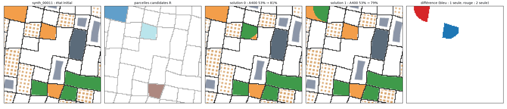

# Références non génératives et paires avant/après (phase 4)

Code : `src/happycity/baselines/placement.py`, `src/happycity/data/pairs.py`.
Commande : `happycity make-pairs`. Tests : `tests/test_baselines.py` (scène calculable à
la main).

## Contraintes communes

Toutes les méthodes respectent les contraintes de l'opérateur de projection (phase 5) :

- ajouts **uniquement sur des parcelles candidates adjacentes au réseau piéton** ;
- surface ajoutée ≤ budget b ;
- si une parcelle dépasse le budget restant, on n'en prend qu'un **morceau compact** : les
  pixels les plus proches du pixel de la parcelle le plus proche du réseau.

  Une première version prenait « les pixels les plus proches du réseau », ce qui donnait
  des **anneaux** le long des rues (îlots bordés de rues sur tous les côtés). Ce sont des
  formes d'espace vert peu plausibles que le GAN aurait apprises. C'est corrigé et testé
  (morceau connexe).

Budget : `b = fraction × surface de la tuile`, avec 1 %, 2 %, 3 % et 5 %, soit 163, 327,
491 et 819 px (1,0 à 5,2 ha).

## Méthodes

| Méthode | Règle |
|---|---|
| **Aléatoire valide** | parcelles adjacentes dans un ordre aléatoire, jusqu'à épuiser le budget (moyenne de 10 tirages) |
| **Glouton** | à chaque étape, l'ajout qui dessert le plus de **nouvelles** origines ; meilleur de deux critères (gain par pixel, gain absolu) ; s'arrête si plus aucun gain |
| **Glouton stochastique** | tirage parmi les k = 3 meilleurs ajouts (gain par pixel) |

L'objectif du glouton est **exact** : l'accès après aménagement est l'union des origines
desservies par chaque ajout, puisque A400 dépend de la source la plus proche. Les scores
rapportés sont néanmoins recalculés par le module de métriques indépendant, et un test
vérifie que les deux coïncident.

Le glouton n'est **pas optimal**. Sur `mabrouka_11` par exemple, une solution stochastique
atteint 88,4 % contre 87,2 % pour le glouton. Une cible « atteignable par le glouton » est
donc une **estimation par le bas** de ce qui est atteignable.

## Paires (supervision simulée)

Pour chaque tuile exploitable et chaque budget :

1. 8 tirages du glouton stochastique ;
2. on garde les solutions de **qualité voisine** : gain d'accès ≥ 80 % du meilleur gain
   connu (glouton compris). Sans ce filtre, on obtenait par exemple 66 % et 18 % pour une
   même carte ;
3. on retient au plus 3 solutions **distinctes** ;
4. condition `a` = A400 réellement atteint par la solution (étiquetage a posteriori),
   donc toujours atteignable.

Les cas sans aucun gain d'accès possible sont **exclus** et comptés. Les métadonnées
conservées sont : budget, saturation (capacité < b), A400/V/E avant et après, nombre de
pixels et de parcelles, diversité.

Ces paires sont une **supervision simulée**, pas des projets urbains réalisés.

## Découpage (fixé avant de créer les variantes)

| Split | Contenu | Tuiles | Paires |
|---|---|---|---|
| train | Massira + Mabrouka + ≈ 80 % du synthétique | 500 | 5 223 |
| val_synth | ≈ 10 % des cartes synthétiques (suivi de l'entraînement) | 66 | 684 |
| test_synth | ≈ 10 % des cartes synthétiques (test synthétique, rapporté **à part**) | 44 | 468 |
| val | Hivernage (réel) | 5 | 36 |
| test | Guéliz (réel) — **test final** | 7 | 32 |

Les fractions synthétiques effectives (11 % et 7,4 %) s'écartent de 10 % par le hasard du
hachage sur 598 cartes.

`check_split_integrity` refuse toute tuile présente dans deux splits, toute tuile réelle
hors du split de son quartier, et toute tuile synthétique hors de train/val_synth/test_synth. Les
cartes synthétiques sont réparties par carte (hachage stable de l'identifiant), jamais
par paire.

## Résultats des références (A400 moyen au même budget)

| Groupe | b | A400 avant | Aléatoire | Glouton |
|---|---|---|---|---|
| synthétique (598 tuiles) | 1 % | 44,1 % | 68,9 % | **82,3 %** |
| synthétique | 2 % | 44,1 % | 78,3 % | **89,1 %** |
| synthétique | 5 % | 44,1 % | 89,3 % | **92,3 %** |
| test réel, Guéliz (7) | 1 % | 49,2 % | 62,6 % | 63,0 % |
| test réel, Guéliz (7) | 5 % | 49,2 % | 62,5 % | 63,0 % |
| val réel, Hivernage (7) | 1–5 % | 45,8 % | 68,7–69,9 % | 69,9 % |

## Constats importants pour la suite

1. **Sur le synthétique, le placement compte** : le glouton dépasse l'aléatoire de 13 points
   à 1 % de budget. L'écart diminue avec le budget, car tout finit par être desservi.
2. **Sur les tuiles réelles, il n'y a presque pas de choix** : 1 à 3 parcelles par tuile,
   et **63 % des paires de test ont un budget saturé** (capacité < b). Glouton ≈ aléatoire
   (63,0 % contre 62,6 %), et 1,25 solution distincte en moyenne par tuile × budget en
   test. Le test réel pourra mesurer la **validité** et la **fidélité à la cible**, mais
   **peu discriminer** la qualité du placement.
3. **Quartiers où l'accès ne peut pas augmenter** : `hivernage_20` et `hivernage_21`
   (déjà desservies à 92–100 %).
4. La diversité diminue quand le budget augmente (1 − IoU de 0,67 à 1 % contre 0,42 à 5 %) :
   avec beaucoup de budget, les solutions finissent par prendre les mêmes parcelles.

## Version 2 : cibles intermédiaires (correction de la phase 7)

**Problème** : en v1, toutes les solutions dépensaient le budget au mieux. Pour une tuile et
un budget donnés, a valait donc toujours le maximum atteignable (écart moyen de 0,023 entre
les cibles d'un même couple tuile × budget). La cible était redondante avec b, et les modèles
ont appris à l'ignorer : pente de réponse ≈ 0 (`docs/evaluation.md`).

**Correction** (`pairs.target_fractions: [0.25, 0.5, 0.75]`) : pour chaque tuile × budget, on
ajoute aux solutions « max » des solutions du **glouton ciblé stochastique**, arrêté à
A400 avant + q × (meilleur A400 − A400 avant). La cible a reste l'A400 **réellement atteint**,
donc toujours atteignable. Les doublons, à budget égal, sont écartés. La colonne `kind` vaut
`max` ou `cible 0.25|0.50|0.75`.

| | v1 | v2 |
|---|---|---|
| paires conservées | 6 443 | 12 157 |
| écart moyen de a à tuile × budget fixe | 0,023 | **0,209** |
| tuile × budget où a varie de plus de 0,05 | 18 % | **86 %** |
| paires à plus de 25 % sous le maximum | 0 % | **28 %** |

| split | max | cible 0,25 | cible 0,50 | cible 0,75 |
|---|---|---|---|---|
| train | 5 223 | 1 840 | 1 449 | 1 322 |
| val_synth | 684 | 250 | 196 | 177 |
| test_synth | 468 | 171 | 127 | 118 |
| val (Hivernage) | 36 | 12 | 4 | 8 |
| test (Guéliz) | 32 | 21 | 15 | 4 |

Les solutions « max » sont identiques à celles de la v1 (mêmes graines). Les modèles v1 et
leurs données sont archivés dans `experiments_v1/`.
