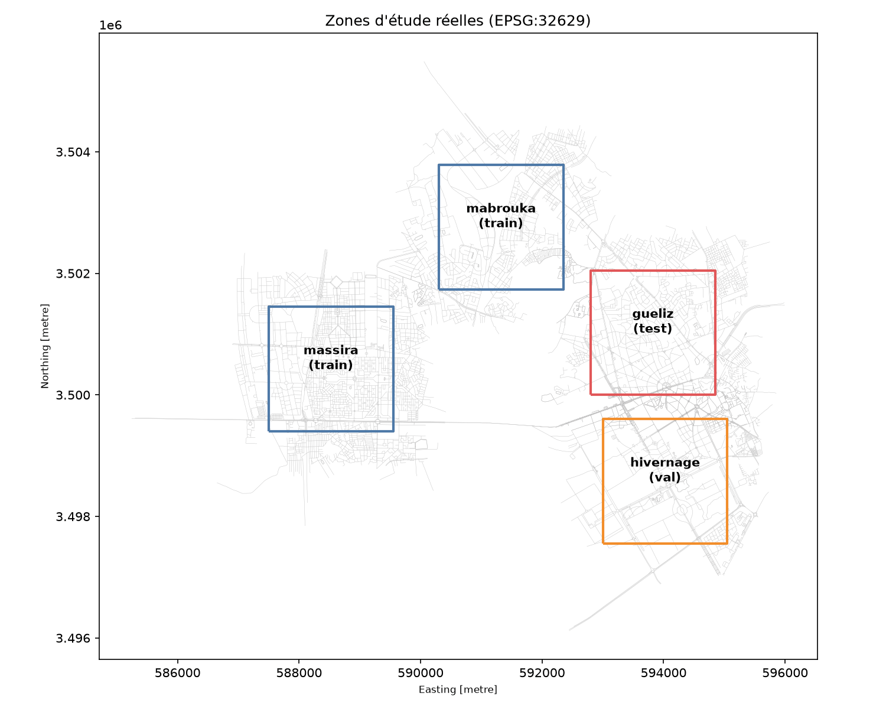

# Rapport de couverture OSM (phase 1)

Source : extrait Geofabrik du 12/11/2026. Indicateurs calculés **dans** chaque zone de
2048 m × 2048 m (4,19 km²). Commande : `happycity coverage-report` ; sorties complètes
dans `data/interim/coverage/` ; copies dans `docs/figures/`.

| | Guéliz (test) | Hivernage (val) | Mabrouka (train) | Massira (train) |
|---|---|---|---|---|
| bâtiments | 2 397 | 593 | 2 181 | 2 500 |
| emprise bâtie | 0,25 | 0,09 | 0,16 | 0,27 |
| part résidentielle | 97 % | 80 % | 97 % | 99 % |
| … dont règle « par défaut » | 11 % | 8 % | 1 % | 4 % |
| réseau piéton (km/km²) | 21,8 | 17,5 | 16,8 | 29,3 |
| part de voies piétonnes dédiées | 13 % | 46 % | 3 % | 29 % |
| tronçons avec trottoir étiqueté | 0,2 % | 0,6 % | 0 % | 1,3 % |
| espaces verts comptés | 21 (8,3 ha) | 6 (9,2 ha) | 10 (2,6 ha) | 3 (0,3 ha) |
| V = A_vert / A_zone | 2,0 % | 2,2 % | 0,6 % | 0,07 % |
| espaces verts sans entrée | 6 | 1 | 6 | 1 |
| espaces verts exclus | 1 (Majorelle, payant) | 8 (privés, Mamounia) | 0 | 0 |
| parcelles candidates | 11 (8,7 ha) | 12 (5,8 ha) | 8 (29 ha) | 3 (3,1 ha) |
| origines résidentielles | 2 311 | 456 | 2 093 | 2 458 |
| origines écartées (> 100 m du réseau) | 31 | 91 | 172 | 36 |
| verdict | ✅ exploitable | ⚠️ faible emprise bâtie | ✅ exploitable | ⚠️ peu de parcelles |

## Lecture

- **Guéliz** : la zone la mieux renseignée (parcs nommés : Cyber Parc Arsat Moulay
  Abdeslam, Jardin des agrumes, Park Harti…). Le jardin Majorelle est correctement exclu
  (payant).
- **Hivernage** : la moitié sud de la zone est occupée par les **oliveraies de la Ménara**
  (`landuse=orchard`, > 140 ha), exclues comme le demande le cahier. La faible emprise
  bâtie est donc **réelle**, ce n'est pas un défaut de couverture. Les jardins de la
  Mamounia (hôtel) et 7 jardins `access=private` sont exclus.
- **Mabrouka** : un tissu résidentiel cohérent de part et d'autre de la voie ferrée, ce qui
  conforte la position supposée (un seul repère OSM). Une grande friche (`natural=scrub`,
  environ 20 ha) concentre l'essentiel des parcelles candidates.
- **Massira** : un tissu très dense mais presque sans espace vert (V = 0,07 %) et avec
  seulement 3 parcelles candidates. Les terrains libres n'y sont pas étiquetés.
- **Trottoirs** : presque jamais étiquetés. Le graphe piéton repose donc sur la voirie
  ouverte aux piétons (filtre `walk` d'OSMnx), pas sur les trottoirs.
- **Entrées** : seulement 1 entrée OSM explicite ; toutes les autres sont déduites
  (nœuds à ≤ 15 m du contour).

## Conséquences

- **Jalon J1** : le corpus réel est prêt et reproductible (extraction complète en environ
  10 min). Mais il est **petit** (4 zones × 4 tuiles = 16 tuiles, moins après les
  exclusions de la phase 2) et pauvre en parcelles candidates. On garde
  `data.source=mixed` : **entraînement surtout sur synthétique, test et démo sur le réel**.
- **Découpage** : Guéliz en test (la zone la plus riche, donc le test le plus informatif),
  Hivernage en val, Massira et Mabrouka en train. Guéliz et Hivernage, voisins et
  semblables, ne sont jamais l'un en train et l'autre en test. Le tampon de 400 m entre
  splits est respecté (Guéliz–Hivernage : 400 m ; Guéliz–Mabrouka : 452 m).
