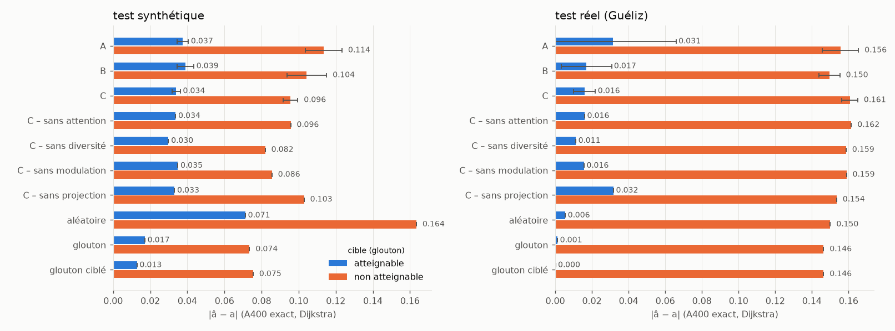
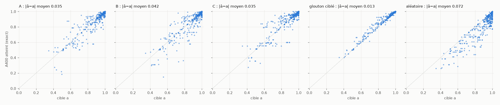
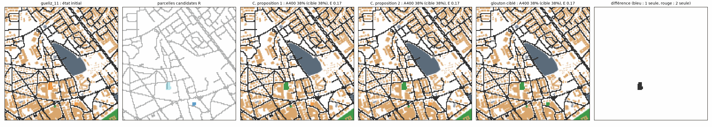

# Évaluation : variantes, ablations et références (phase 6)

> **Version** : les résultats ci-dessous sont ceux des **modèles v1**, archivés dans
> `experiments_v1/`. Ils ont été entraînés sur des paires où a valait toujours le maximum
> atteignable, et ils ignorent a. Les paires v2 (`docs/baselines_pairs.md`) corrigent ce
> défaut. Les modèles v2 sont à réentraîner sur Kaggle, puis à réévaluer avec
> `happycity evaluate` ; ce document sera alors mis à jour.

Code : `src/happycity/evaluation/`. Commande : `happycity evaluate`, avec les options
`--runs` (motif) et `--splits`. Sorties dans `experiments/evaluation/` :
`results.parquet` (une ligne par proposition), `report.md`, `summary_<split>.csv` et
`figures/`. Le rapport complet est copié dans
[figures/evaluation_report.md](figures/evaluation_report.md).

> **Graines** : A, B et C sont entraînés avec 3 graines (42, 43, 44), rangées dans
> `experiments/seed42|seed43|seed44/`. Les résultats sont donnés en moyenne ± écart-type
> **entre graines**. Les 4 ablations de C n'ont qu'une graine (42) : leurs écarts sont à
> comparer à la variabilité de C entre graines.

## Protocole

**Problèmes (tuile, budget b, cible a)** sur deux splits :

- `test` : Guéliz, réel, **test final** ;
- `test_synth` : test synthétique tenu à l'écart, **rapporté à part**.

**Types de cible** :

- *a posteriori* : a = A400 d'une solution connue, donc une solution valide existe ;
- *inatteignable (+0,10 / +0,25)* : a = A400 du glouton + δ, plafonné à 1.

La colonne « atteignable par le glouton (oui/non) » sépare les résultats. Le glouton n'est
**pas optimal** : sur `test_synth`, 12 cibles a posteriori dépassent ce qu'il atteint.
« Atteignable » est donc une estimation **par le bas**.

| split | a posteriori (atteignable) | a posteriori (non) | inatteignable +0,10 | +0,25 |
|---|---|---|---|---|
| test_synth | 456 | 12 | 152 | 152 |
| test (Guéliz) | 32 | 0 | 28 | 28 |

**Mesure** : 3 propositions par problème, avec les **mêmes z pour tous les modèles**. Les
métriques sont **exactes** : module indépendant, Dijkstra sur le réseau piéton. On mesure :

- |â − a| ;
- A400 et ΔA400 ;
- **E, toujours avec A400** ;
- V ;
- la validité (hors de R, budget, ajouts détachés du réseau) ;
- la diversité (1 − IoU) ;
- le temps d'inférence.

**Sortie retenue** : projetée pour C, brute pour A, B et C sans projection. La sortie
projetée de A et B est aussi mesurée, pour isoler l'apport de la projection.

**Références** :

- aléatoire valide (10 tirages) ;
- glouton ;
- **glouton ciblé** : il s'arrête dès que A400 ≥ a. C'est la référence non générative qui
  reçoit, comme le GAN, la cible a.

Ces indicateurs mesurent l'**accès piéton à 400 m** et la **couverture végétale**. Ils ne
mesurent pas le bien-être des habitants, et rien ici ne permet d'affirmer qu'un aménagement
les rendrait plus heureux.

## Résultats, test synthétique (A, B, C : 3 graines)

| méthode | \|â−a\| atteignable | \|â−a\| non atteignable | A400 après | E après | valide | diversité |
|---|---|---|---|---|---|---|
| A | 0,037 ± 0,003 | 0,114 ± 0,010 | 86,5 ± 0,6 % | 0,721 ± 0,007 | **16 ± 11 %** | 0,161 ± 0,058 |
| B | 0,039 ± 0,004 | 0,104 ± 0,011 | 86,9 ± 1,1 % | 0,721 ± 0,019 | **19 ± 4 %** | 0,110 ± 0,009 |
| **C** | 0,034 ± 0,002 | 0,096 ± 0,004 | 87,7 ± 0,5 % | 0,738 ± 0,008 | **100 %** | 0,039 ± 0,003 |
| aléatoire | 0,071 | 0,164 | 81,2 % | 0,608 | 100 % | 0,585 |
| glouton | 0,017 | 0,074 | 89,7 % | 0,788 | 100 % | — |
| glouton ciblé | **0,013** | 0,075 | 89,3 % | 0,781 | 100 % | — |

Ablations de C (graine 42 seule) : |â−a| atteignable 0,030 à 0,035, toutes valides à 100 %.

## Résultats, test réel Guéliz (A, B, C : 3 graines)

| méthode | \|â−a\| atteignable | \|â−a\| non atteignable | A400 après | E après | valide |
|---|---|---|---|---|---|
| A | 0,031 ± 0,035 | 0,156 ± 0,010 | 65,9 ± 3,4 % | 0,408 ± 0,061 | **7 ± 6 %** |
| B | 0,017 ± 0,014 | 0,150 ± 0,006 | 64,8 ± 1,1 % | 0,382 ± 0,012 | **4 ± 4 %** |
| C | 0,016 ± 0,006 | 0,161 ± 0,004 | 62,8 ± 0,5 % | 0,372 ± 0,008 | 100 % |
| aléatoire | 0,006 | 0,150 | 63,9 % | 0,386 | 100 % |
| glouton ciblé | 0,000 | 0,146 | 64,3 % | 0,388 | 100 % |

## Constats (3 graines pour A, B et C)

1. **Les modèles ignorent la cible a : constat principal, ajouté en phase 7.** Le test de
   réponse à la condition (section suivante) donne une pente de ≈ 0 pour A, B et C sur les
   3 graines. Dans 96 à 98 % des cas, demander une cible basse ou haute produit la même
   proposition. Les modèles **maximisent l'accès avec le budget b**, quelle que soit a.
2. **La faible erreur |â − a| des cibles a posteriori est donc trompeuse.** Ces cibles valent
   presque toujours l'A400 maximal atteignable (0,034 pour C). Un modèle qui maximise tombe
   juste sans utiliser a ; sur une cible basse, son erreur monte à 0,31. Les différences
   entre A, B et C sur |â − a| sont de l'ordre de la variabilité entre graines, et **la
   modulation FiLM (B) n'apporte rien de mesurable** : elle module une information que le
   modèle n'exploite pas.

   **Cause** : les paires d'entraînement (phase 4) viennent du glouton stochastique, qui
   dépense tout le budget. Pour une tuile et un budget donnés, a est donc toujours proche
   du maximum et n'apporte aucune information de plus que b. Corriger cela demande des
   paires où a varie à budget fixe, donc un réentraînement.
3. **La validité est l'apport net et robuste de C.** C est valide à 100 % pour les 3 graines.
   A (16 ± 11 %) et B (19 ± 4 %) ne le sont que rarement en sortie brute, et la qualité
   d'une graine à l'autre est très variable pour A.
   - Violation dominante sur le synthétique : morceaux **détachés** du réseau, dans 75 à
     80 % des propositions de A et B.
   - Sur Guéliz : ajouts **hors de R**, dans 79 à 87 % des propositions.
   - Projeter a posteriori les sorties de A et B les rend valides sans dégrader |â−a|.
     **La projection est donc l'ingrédient décisif**, et elle s'applique à n'importe quel
   modèle.
4. **L'A400 plus élevé de A sur Guéliz est un artefact** d'ajouts placés hors des parcelles
   autorisées. Projeté, A retombe au niveau des autres.
5. **Le test réel ne discrimine pas les méthodes.** Guéliz compte 1 à 3 parcelles par tuile
   et des budgets saturés : l'aléatoire y fait aussi bien que les autres. Il vérifie la
   **validité** sur des données réelles (C : 100 %), pas la qualité du placement.
6. **Diversité : C est 3 à 4 fois moins divers que A et B** (0,039 ± 0,003 contre 0,11 à
   0,16), et c'est stable entre graines. C sans projection remonte à 0,085 : la restriction
   à R pendant l'entraînement concentre les sorties. Retirer les pertes de diversité ne la
   change presque pas (0,033) : avec ces poids, MSGAN et la régression latente ont un effet
   marginal. **Il y a un arbitrage entre validité et diversité.**
7. **Ablations de C (une graine)** : de 0,030 à 0,035 sur les cibles atteignables, contre
   0,034 ± 0,002 pour C. Aucune n'est significativement moins bonne : **ni l'attention ni la
   modulation ne montrent d'effet mesurable.** « Sans diversité » est même légèrement
   meilleur (0,030), ce qui reste à confirmer avec d'autres graines.
8. **Cibles inatteignables** : C reste valide et s'approche de l'A400 maximal sans
   l'atteindre (0,096 contre 0,074 pour le glouton, qui est la borne basse).
9. **E se lit avec A400** : les méthodes qui augmentent le plus A400 augmentent aussi le
   plus E. Aucun arbitrage entre accès moyen et équité n'apparaît dans ces données.

## Réponse à la condition a (ajout de la phase 7)

Commande : incluse dans `happycity evaluate`, module `evaluation/condition.py`. Pour chaque
tuile de `test_synth` et chaque budget (2 % et 3 %), on demande deux cibles :

- **basse** : A400 avant + 25 % de l'écart jusqu'au glouton ;
- **haute** : A400 du glouton.

On ne garde que les cas où l'écart entre ces deux cibles est d'au moins 0,10, et les codes z
sont les mêmes pour les deux cibles.

**Pente** = variation d'A400 obtenue / variation demandée : 1 si a est suivie, 0 si elle est
ignorée. Le tableau à jour est dans
[figures/evaluation_report.md](figures/evaluation_report.md).

| méthode | pente (idéal 1) | sans réaction (pente < 0,1) | \|â−a\| cible basse | \|â−a\| cible haute |
|---|---|---|---|---|
| A (3 graines) | −0,01 ± 0,02 | 98 % | 0,314 ± 0,004 | 0,034 ± 0,004 |
| B (3 graines) | 0,01 ± 0,02 | 96 % | 0,310 ± 0,017 | 0,034 ± 0,005 |
| C (3 graines) | 0,01 ± 0,01 | 97 % | 0,310 ± 0,009 | 0,031 ± 0,002 |
| glouton ciblé | 0,50 | 8 % | 0,159 | 0,002 |

Le glouton ciblé n'atteint qu'une pente de 0,5, car il ajoute des parcelles entières et
dépasse souvent une cible basse. Lui réagit pourtant à a ; les modèles, non.

## Limites

- Trois graines pour A, B et C, une seule pour les ablations.
- Supervision **simulée** : les cibles viennent du glouton stochastique, pas de projets
  réels. Elles saturent le budget, si bien que **la condition a n'est pas apprise** (voir
  ci-dessus).
- Test réel petit (7 tuiles, 32 paires) et peu discriminant.
- A400 doux à l'entraînement, exact à l'évaluation : les écarts rapportés sont ceux de la
  métrique exacte.
