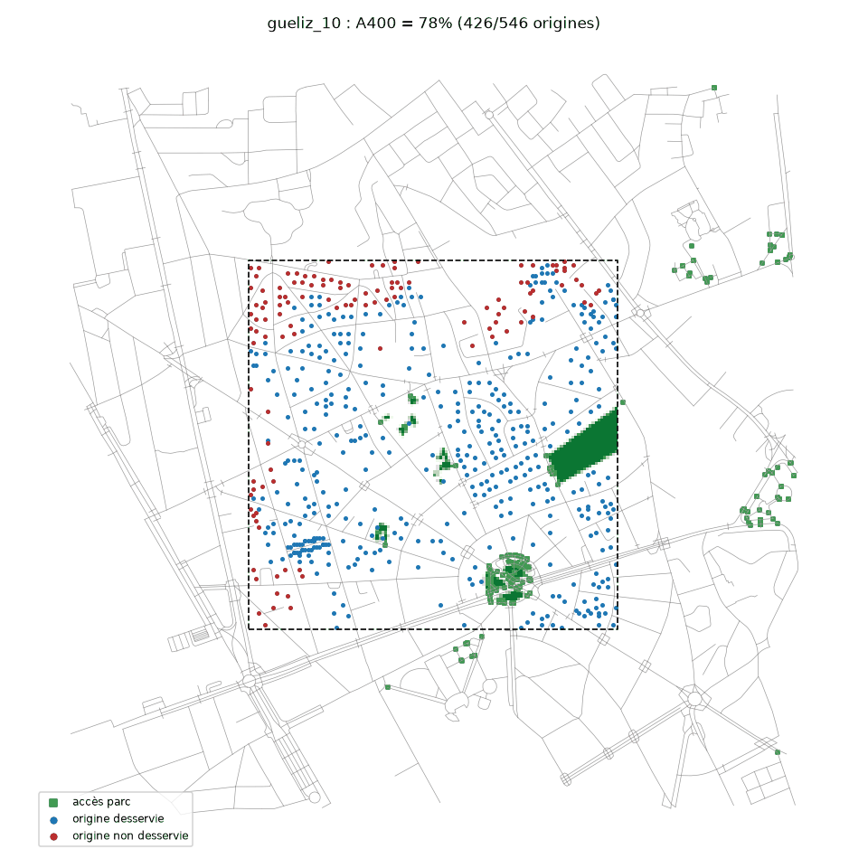

# Métriques V, A400, E (phase 3)

Code : `src/happycity/metrics/`, un module **autonome**. Il n'importe ni torch ni aucun
autre module `happycity` (vérifié par `tests/test_architecture.py`). Il reçoit des
tableaux et un graphe, et évalue donc de la même façon toute proposition : GAN, glouton,
aléatoire ou masque dessiné à la main.

Tests : `tests/test_metrics.py` (mini-cartes calculables à la main),
`tests/test_access_context.py` (recoupement avec NetworkX).

> Ces indicateurs sont des **proxies spatiaux d'accessibilité**. Ils ne mesurent pas le
> bien-être subjectif. L'OCDE documente l'accès à un espace vert à 400 m, et la CEE-ONU
> mentionne l'accès à cinq minutes de marche.

## Définitions

Même projection (EPSG:32629) et même périmètre (la tuile de 1024 m) avant et après.

### Couverture végétale V

`V = A_vert / A_zone`. A_vert est la surface des espaces verts **comptés** (publics ou
accessibles, `docs/osm_rules.md`) dans la tuile, plus les ajouts. Un pixel déjà
partiellement vert n'est pas compté deux fois : on prend `max(existant, ajout)`.
`check_budget` lève `BudgetExceededError` si **ΔA_vert > b**.

### Accessibilité A400

`A400 = (1/N) Σ_i 1[min_{p∈P} d_G(r_i, p) ≤ 400 m]`

- `d_G` : plus court chemin sur le **graphe piéton fixe** (Dijkstra multi-sources depuis
  les points d'accès, arrêté à 400 m), jamais à vol d'oiseau.
- `r_i` : nœud du graphe auquel l'origine résidentielle est rattachée (fixe avant/après).
- `P` : points d'accès des espaces verts :
  - les **entrées OSM explicites** (nœuds) si l'espace vert en a ;
  - sinon, pour chaque tronçon à ≤ 15 m du contour, le **point le plus proche sur le
    tronçon**. Sa distance aux deux extrémités (`t` et `L − t`) est prise en compte.

  La même règle s'applique aux **nouveaux** espaces verts (polygones des pixels ajoutés).
  On ne se limite donc pas aux nœuds : un parc le long d'un grand tronçon reste
  accessible.
- Un seuil de 400 m pile compte comme un accès (tolérance de 0,1 mm, due à la source
  virtuelle de Dijkstra).
- Sans données de population, c'est une **proportion d'origines** (bâtiments
  résidentiels), pas la proportion officielle de population.

**Exactitude du sous-graphe** : chaque tuile ne garde que les nœuds à ≤ 400 + 100 m de la
tuile. Tout chemin de ≤ 400 m partant d'une origine y reste, car une origine est à
≤ 100 m de son nœud. Le recoupement avec le Dijkstra multi-sources de NetworkX sur le
graphe complet donne un résultat **identique** : test sur carte synthétique, et contrôle
manuel sur `gueliz_10` (1 398 nœuds sur 3 114 ; A400 = 75,46 % des deux côtés).

### Équité spatiale E

`E = 1 − (max_q A400^(q) − min_q A400^(q))`, sur **4 quadrants fixes** de 512 m.

- Un secteur n'est retenu que s'il a au moins 10 origines.
- S'il reste moins de 2 secteurs, E vaut `NaN` (compté à part).
- Une égalité à zéro accès donne E = 1 : **E est toujours rapporté avec A400**.
- Au niveau du quartier, les secteurs sont les 4 tuiles disjointes de la zone.

## Cas de test calculés à la main

| Cas | Attendu |
|---|---|
| parc à 300 m / 400 m / 500 m par la rue | accès / accès / pas d'accès |
| point d'accès au milieu d'un tronçon (350 m, 450 m) | accès / pas d'accès |
| chemin en U : parc à 50 m à vol d'oiseau, 650 m par le réseau | pas d'accès |
| origine dans une composante déconnectée | pas d'accès |
| deux arêtes parallèles (500 m et 100 m) | 100 m retenu |
| aucune origine | A400 = NaN |
| ajout sur un pixel à moitié vert | +0,5 pixel seulement |
| ΔA = b / ΔA > b | accepté / `BudgetExceededError` |
| secteurs 100 % et 50 % | E = 0,5 |
| un seul secteur ≥ 10 origines | E = NaN |
| tous les secteurs à 0 % | E = 1 (et A400 = 0) |
| 2 px verts au bord de la rue au nœud 9 (900 m du nœud 0) | A400 = 0,5 ; E = 0 |
| verdir une parcelle | A400 ne diminue jamais |

## État initial (`happycity access`)

La commande calcule pour chaque tuile le contexte d'évaluation
(`data/processed/context/<tuile>.npz`), les valeurs V, A400 et E avant aménagement
(colonnes `*_before` de `tiles.parquet`) et le canal dérivé **`unserved_origins`**
(origines non desservies par pixel), ajouté aux tuiles.

### Quartiers (4 tuiles disjointes, E entre tuiles)

| Quartier | Split | Origines | A400 | E | A400 min–max par tuile |
|---|---|---|---|---|---|
| Guéliz | test | 2 311 | 41,8 % | 0,13 | 0 – 87 % |
| Hivernage | val | 456 | 46,5 % | 0,08 | 8 – 100 % |
| Mabrouka | train | 2 093 | 35,2 % | 0,39 | 0 – 61 % |
| Massira | train | 2 458 | 15,1 % | 0,76 | 0 – 24 % |

Massira a l'E le plus élevé **parce que** l'accès y est faible partout (0 à 24 %) :
c'est l'illustration du piège d'une égalité dans la pénurie.

Tuiles synthétiques : A400 moyen de 44 %, bien réparti de 0 à 100 % (129 tuiles sous
20 %, 64 au-dessus de 80 %). Le synthétique couvre donc des situations de départ variées.

## Limites

- Le rattachement au **nœud** le plus proche (et non au tronçon) peut surestimer
  légèrement la distance des origines en milieu de long tronçon.
- La qualité dépend d'OSM : trottoirs très rarement étiquetés, presque aucune entrée de
  parc explicite. Les entrées sont donc déduites (tronçons à ≤ 15 m).
- Les tuiles réelles se chevauchent : les moyennes par tuile sont corrélées. D'où le
  tableau par quartier sur 4 tuiles disjointes.
