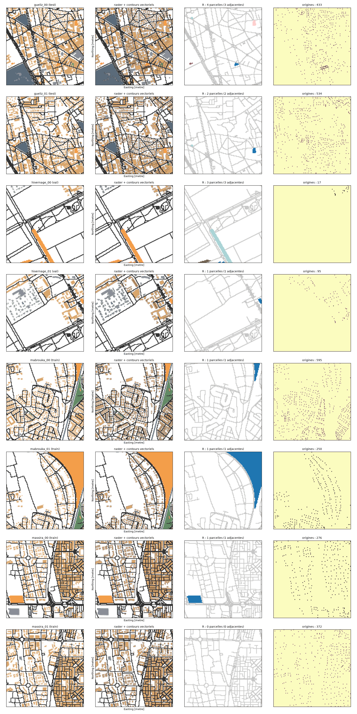

# Rastérisation 128 × 128 et couverture des annotations (phase 2)

Code : `src/happycity/data/raster.py`. Commande : `happycity rasterize`.
Tests : `tests/test_raster.py` (cas calculables à la main).

## Conventions

- Tuile de **128 × 128 px à 8 m/px = 1024 m**, même échelle pour toutes les tuiles,
  réelles et synthétiques.
- La ligne 0 est au nord, la colonne 0 à l'ouest. Le pixel `(r, c)` couvre
  `x ∈ [xmin + 8c, xmin + 8(c+1)]`, `y ∈ [ymax − 8(r+1), ymax − 8r]`.
- Le **graphe piéton et les espaces verts restent vectoriels** : les métriques (phase 3)
  calculent les distances sur le graphe (contexte de 400 m autour de la tuile compris),
  jamais sur le raster.

## Canaux de M (`data.channels`)

| Canal | Contenu | Méthode |
|---|---|---|
| `residential_buildings` | fraction du pixel couverte | suréchantillonnage ×4 (2 m/px), puis moyenne |
| `other_buildings` | idem, bâtiments non résidentiels | idem |
| `walk_network` | 1 si un tronçon piéton touche le pixel | `all_touched` |
| `public_green` | espaces verts **comptés** | suréchantillonnage ×4 |
| `obstacles` | eau, voies ferrées, cimetières… | suréchantillonnage ×4 |
| `origins` | nombre d'origines résidentielles dans le pixel | comptage |

**R** (`candidate_ids`) : identifiant local de la parcelle candidate dont le pixel contient
le centre (−1 sinon). Chaque parcelle de la tuile a une ligne dans la table `candidates` :
identifiant global, règle, surface dans la tuile, nombre de pixels, et **adjacence au
réseau piéton** (≤ 1 px = 8 m d'un tronçon, test vectoriel). Les origines sont aussi
stockées en table (pixel, coordonnées, nœud du graphe) pour les métriques.

Le canal `unserved_origins` (origines sans accès avant aménagement) dépend de l'A400 :
il sera dérivé en phase 3 par le module de métriques à partir de cette table.

Stockage : `data/processed/tiles/<tile_id>.npz` (float16 compressé, environ 27 Ko par
tuile). L'index `data/processed/tiles.parquet` contient une ligne par tuile (emprise,
split, couverture des annotations).

## Tuiles

- **Réelles** : 9 tuiles chevauchantes par zone (pas de 512 m dans 2048 m), soit
  36 tuiles. Les tuiles d'une même zone sont **corrélées** : on rapportera les résultats
  par zone autant que par tuile.
- **Synthétiques** : une tuile par carte, soit 600 tuiles, toutes en `train`.
- **Exclusion entre splits** : une tuile à moins de 400 m d'une zone d'un autre split est
  exclue. Aucune ne l'est ici, puisque les zones sont espacées d'au moins 400 m par
  construction.

## Couverture des annotations

Une tuile est **exploitable** si elle a au moins 30 origines et au moins une parcelle
candidate adjacente au réseau. Une tuile sans parc accessible reste exploitable : son
A400 avant aménagement vaut 0.

| Split | Zone | Tuiles | Exploitables | Origines (moy.) | Parcelles adj. (moy.) | Parcs accessibles (moy.) |
|---|---|---|---|---|---|---|
| test | Guéliz | 9 | 7 | 635 | 2,3 | 10,9 |
| val | Hivernage | 9 | 7 | 105 | 2,6 | 5,3 |
| train | Mabrouka | 9 | 9 | 524 | 3,3 | 3,8 |
| train | Massira | 9 | 3 | 640 | 0,6 | 2,0 |
| train | synthétique | 600 | 598 | 647 | 7,2 | 4,7 |

Le détail par tuile est dans `docs/figures/annotation_coverage.csv`.

Écartées : 2 tuiles de l'Hivernage (17 et 18 origines, oliveraies de la Ménara),
2 de Guéliz et 6 de Massira (aucune parcelle candidate).

**Capacité foncière** : une tuile réelle médiane n'offre que 137 px de parcelles
candidates (environ 0,9 ha), contre 861 px en synthétique. Un budget b de 1 à 5 % de la
tuile (164 à 819 px) dépassera donc souvent la surface disponible sur les tuiles réelles.
Les paires (phase 4) devront noter les budgets **saturés**, sans les traiter comme un
échec du modèle.

## Validation visuelle

`docs/figures/tiles_real.png` et `tiles_synthetic.png` montrent, pour chaque tuile : le
raster, le raster avec les contours vectoriels superposés (contrôle d'alignement), R avec
ses identifiants, et la densité des origines. L'alignement est correct (contours sur les
pixels, nord en haut) et les parcelles adjacentes sont bien identifiées.

## Jalon J1

Le corpus est **constitué** :
- 36 tuiles réelles, dont 26 exploitables (test 7, val 7, train 12) ;
- 600 tuiles synthétiques, dont 598 exploitables.

On garde `data.source=mixed`. Le basculement vers `synthetic` reste possible sans
modifier le code (testé par `tests/test_cli.py`).
